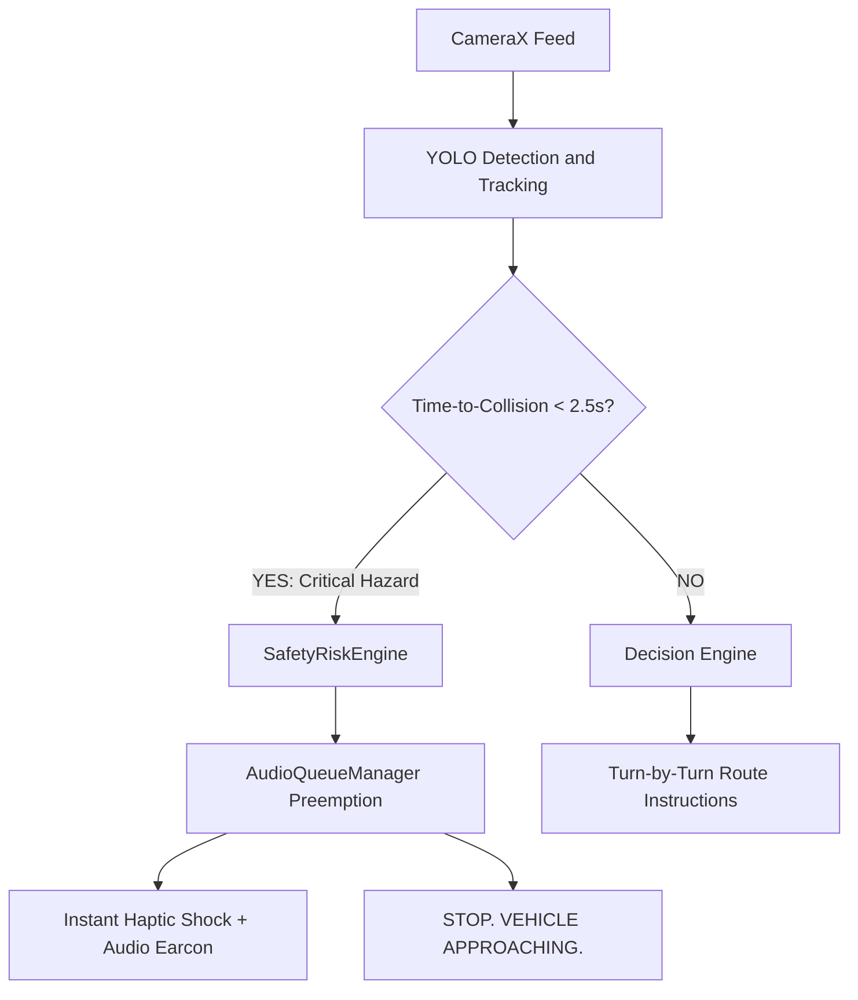
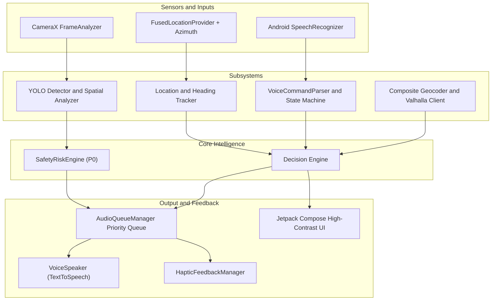

# VisionNav (Vision) 🚶‍♂️👁️

> **Voice-First Pedestrian Navigation & Real-Time On-Device Spatial Obstacle Detection for Android**

[](https://developer.android.com/)
[](https://kotlinlang.org/)
[](https://developer.android.com/jetpack/compose)
[](https://developer.android.com/training/camerax)
[](https://valhalla.github.io/valhalla/)
[](https://ai.google.dev/edge/litert)
[](https://www.w3.org/WAI/standards-guidelines/wcag/)
[](https://github.com/Mano2409/vision)

---

## 📌 Overview

**VisionNav** is an experimental native Android assistive application designed for blind and visually impaired users. Standard navigation software provides turn-by-turn routing, but cannot perceive immediate physical obstructions (poles, street clutter, construction barriers, or oncoming vehicles). 

VisionNav bridges this critical gap by fusing:
1. **Macro-Navigation**: OpenStreetMap-based pedestrian routes calculated via Valhalla with voice maneuver guidance.
2. **Micro-Perception**: Real-time on-device computer vision (YOLO26n / LiteRT) via CameraX that partitions the user's field of view into spatial corridors and estimates obstacle proximity.
3. **Decision & Arbitration Engine**: A central intelligence engine that prioritizes immediate physical hazards over routine turn instructions, delivering concise, actionable speech output without overwhelming the user.

---

## 🚨 P0 Mandatory Pedestrian Safety Architecture

Pedestrian physical safety **strictly overrides** all routine navigation maneuvers, UI animations, and battery-saving cycles.



- **Collision Time-to-Collision ($\text{TTC} < 2.5\text{s}$):** When approaching vehicles (cars, buses, trucks, motorcycles) intersect the user's path, routine speech is instantly cut off (`tts.stop()`).
- **Instant Warning (<50ms):** Hardware vibration alert (`HapticFeedbackManager`) and audio earcons fire simultaneously.
- **Authoritative Commands:** The app commands authoritative actions (e.g., *"STOP. VEHICLE APPROACHING."*). 
- **Anti-Evasive Guessing:** The system **never blindly guesses lateral movements** into traffic; it defaults to commanding an immediate halt until safety is verified.
- **Hysteresis Recovery Window:** Navigation resumes only after the path has remained continuously clear for at least **1.5 seconds**, announcing *"Danger cleared. Resuming route."*

---

## 🏗️ System Architecture

VisionNav is built on a clean, decoupled architecture where vision, location, routing, and speech communicate via reactive Kotlin Coroutines and StateFlow interfaces.



---

## 📊 Project Status & 10-Phase Roadmap

VisionNav is currently under active development. Below is the progress status based on the [VisionNav PRD](./VisionNav_MVP_PRD.md):

| Phase | Milestone | Deliverable & Modules | Status |
| :---: | :--- | :--- | :---: |
| **1** | **Project Foundation** | Android Studio, Kotlin, Jetpack Compose UI scaffold, Permissions, Telemetry Bar | ✅ **Complete** |
| **2** | **Voice Interface** | `SpeechRecognizer`, `VoiceSpeaker` (TTS), `AudioQueueManager` (preemption), Command Parser | ✅ **Complete** |
| **3** | **Location & Geocoding** | `LocationProvider`, `HeadingTracker`, Dual Nominatim + Photon Geocoder with Cache | ✅ **Complete** |
| **4** | **Valhalla Routing** | Pedestrian routing client, polyline decoder, step maneuvers, rerouting engine | ✅ **Complete** |
| **5** | **Camera & Visibility** | CameraX lifecycle, throttled `FrameAnalyzer`, `VisibilityAssistManager` (auto-torch) | ✅ **Complete** |
| **6** | **Vision Pipeline & Safety** | `YoloDetector` interface, `SpatialAnalyzer`, `ObjectTracker`, `SafetyRiskEngine` (TTC < 2.5s) | ✅ **Complete** |
| **7** | **Spatial & Depth Refinement** | INT8/FP16 quantized LiteRT model deployment on target hardware, depth calibration | 🔄 **In Progress** |
| **8** | **Full Decision Fusion** | End-to-end route conflict resolver & multi-hazard arbitration testing | ⏳ **Upcoming** |
| **9** | **Live Voice Navigation Field Trials** | End-to-end destination $\to$ routing $\to$ obstacle detection $\to$ speech field verification | ⏳ **Upcoming** |
| **10** | **Optimization & Release APK** | Thermal throttling mitigation, battery optimization, signed APK build | ⏳ **Upcoming** |

---

## 🌟 Key Features

### 1. Hands-Free Voice Navigation
- **Spoken Destination Entry:** Speak place names or addresses; resolved via dual Photon + Nominatim geocoding.
- **Priority Audio Queue:** Routine navigation messages never talk over urgent hazard warnings.
- **Supported Spoken Commands:**
  - *"Navigate to [destination]"*
  - *"Where am I?"*
  - *"What's ahead?"*
  - *"Repeat"*
  - *"Stop navigation"*
  - *"Start navigation"*

### 2. Pedestrian Routing & Dynamic Rerouting
- OpenStreetMap pedestrian costing via Valhalla API.
- Live progress tracking along route polyline with cadence-gated step countdowns.
- Automatic off-route detection with debounced rerouting calculations.

### 3. Spatial Obstacle Partitioning & Proximity
- Camera frames partitioned into **Left (0–33%)**, **Center (34–66%)**, and **Right (67–100%)** corridors.
- Detections categorized into coarse proximity buckets (**Far**, **Medium**, **Near**, **Critical**).
- Temporal smoothing and alert deduplication to prevent repetitive speech fatigue.

### 4. Built-in Simulation Engine
- Test and verify the app indoors without GPS or live walking routes:
  - `SimulatorRoutePlayer`: Plays recorded pedestrian paths with simulated coordinates.
  - `VisionScenarioSimulator`: Injects obstacle scenarios (approaching vehicles, blocked sidewalks, low-light conditions) for automated verification.

### 5. High-Contrast Accessibility UI
- Designed to meet **WCAG AAA** contrast standards (pure black background `#000000`, vibrant high-contrast accents).
- Full-screen touch surface for speech input.
- Developer telemetry overlay showing active FPS, inference latency, GPS accuracy, and compass bearing.

---

## 📂 Repository Structure

```
vision/
├── app/
│   ├── src/main/
│   │   ├── java/com/visionnav/
│   │   │   ├── audio/          # Speech-to-text, TTS, priority audio queue
│   │   │   ├── camera/         # CameraX pipeline & frame analyzer
│   │   │   ├── core/           # Decision engine & conflict resolution
│   │   │   ├── location/       # Fused GPS & compass heading tracking
│   │   │   ├── navigation/     # Route progression coordinator & rerouting
│   │   │   ├── routing/        # Valhalla routing & Photon/Nominatim geocoding
│   │   │   ├── safety/         # Critical hazard detection & torch assist
│   │   │   ├── simulator/      # Indoor GPS & vision mock player
│   │   │   ├── ui/             # Jetpack Compose screens, theme & telemetry
│   │   │   └── vision/         # YOLO detection, spatial & corridor analysis
│   │   └── assets/models/      # On-device ML models (.tflite) and labels
├── gradle/                     # Gradle wrapper
├── build.gradle.kts            # Project-level build script
├── settings.gradle.kts         # Subproject repository settings
├── VisionNav_MVP_PRD.md        # Complete Product Requirements Document
└── progress.html               # Interactive visual roadmap & subsystem tracker
```

---

## 🚀 Getting Started

### Prerequisites
- **Android Studio**: Ladybug (2024.2+) or Iguana+
- **JDK**: Version 17
- **Target Device**: Physical Android device running **Android 8.0 (API 26)** or higher (API 34 recommended)
- **Device Capabilities**: Rear Camera, GPS, Microphone, Speaker, Haptic Motor

### Installation & Build

1. **Clone the repository:**
   ```bash
   git clone https://github.com/Mano2409/vision.git
   cd vision
   ```

2. **Open in Android Studio:**
   - Select **Open an Existing Project** and navigate to the cloned folder.
   - Allow Gradle to sync dependencies.

3. **Run Unit & Integration Tests:**
   ```bash
   # On Windows (PowerShell)
   .\gradlew.bat test

   # On macOS / Linux
   ./gradlew test
   ```

4. **Install Debug APK on Device:**
   - Connect your Android phone via USB with **USB Debugging** enabled.
   ```bash
   .\gradlew.bat installDebug
   ```

---

## 🔗 Pushing to Your GitHub Repository

To connect this local project to your personal GitHub repository (`Mano2409/vision`):

1. **Create the repository on GitHub:**
   - Go to [github.com/new](https://github.com/new)
   - Repository name: `vision`
   - Visibility: Public or Private (do not initialize with README)

2. **Update the Git remote and push:**
   ```bash
   # Point origin to your GitHub account
   git remote set-url origin https://github.com/Mano2409/vision.git

   # Verify remote URL
   git remote -v

   # Stage changes and commit
   git add .
   git commit -m "feat: complete phases 1-6C and add comprehensive README"

   # Push to main branch
   git push -u origin main
   ```

*(If your GitHub repository was created with an initial commit, use `git push -u origin main --force` or rebase prior to pushing).*

---

## ⚠️ Assistive Technology Disclaimer

> **IMPORTANT NOTICE:**  
> **VisionNav is an experimental research and assistive software prototype.**  
> It is **NOT** a certified medical device, autonomous navigation tool, or safety-critical traffic assistant. It is **NOT** designed or intended to replace primary mobility aids such as a white cane, guide dog, or orientation and mobility training. Users must always maintain independent situational awareness and exercise personal judgment during pedestrian travel.

---

## 📄 License

This project is open-source under the [MIT License](LICENSE) (or Apache 2.0).

